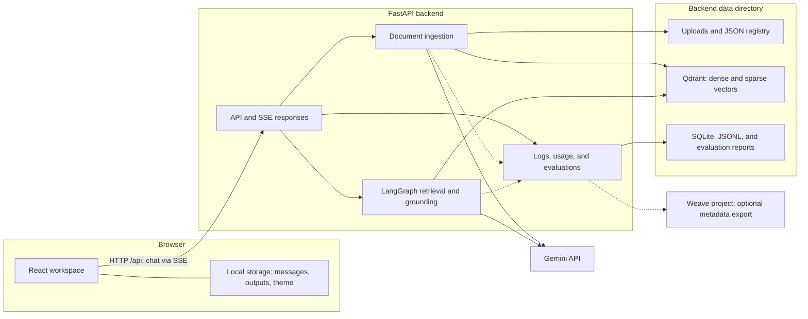
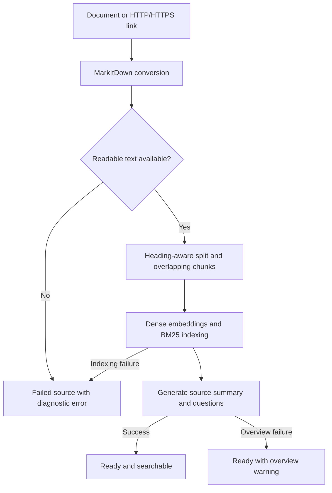
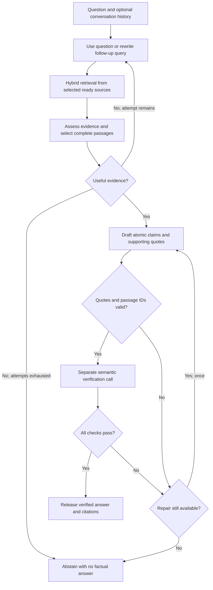
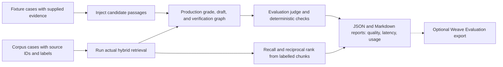

# Notebook RAG

A document research workspace with source-grounded chat, cited summaries, quality evaluations, and token and cost observability.

Notebook RAG combines Gemini, LangGraph, Qdrant hybrid retrieval, and MarkItDown behind a FastAPI service and a React interface. Its bounded retrieval loop searches selected sources, checks evidence, verifies drafted claims, and either returns a cited answer or abstains.

**Project status:** local development application. The repository includes grounding controls and regression checks; production deployment, complete online benchmark coverage, and formal compliance certification have not been established.

## Contents

- [Capabilities](#capabilities)
- [Architecture](#architecture)
- [Requirements](#requirements)
- [Quick start](#quick-start)
- [Configuration](#configuration)
- [Grounding and guardrails](#grounding-and-guardrails)
- [Evaluations](#evaluations)
- [Observability and cost accounting](#observability-and-cost-accounting)
- [API reference](#api-reference)
- [Project structure](#project-structure)
- [Development checks](#development-checks)
- [Operations, privacy, and deployment](#operations-privacy-and-deployment)
- [Troubleshooting](#troubleshooting)
- [Contributing and support](#contributing-and-support)
- [License](#license)
- [References](#references)

## Capabilities

| Area | Implemented behavior |
| :--- | :--- |
| Source library | Select or drop multiple documents; paste multiple links; track each addition; retry failures; inspect and select sources. |
| Ingestion | Convert content to Markdown, split by headings, create overlapping passages, and index dense and sparse vectors. |
| Retrieval | Gemini embeddings plus FastEmbed BM25, fused by Qdrant and filtered to selected source IDs. |
| Agent workflow | Rewrite follow-up queries, assess retrieved evidence, and retry retrieval up to two attempts. |
| Grounding | Structured atomic claims, exact evidence anchors, a separate semantic verification call, one repair, and abstention. |
| Chat | Individual conversations with separate histories, drafts and Studio outputs; create, rename, select and delete chats. Progress, verified answers, clickable citations and run-specific model metadata are recorded. |
| Sharing | Export an answer, Studio output or conversation to Markdown or standalone HTML with cited supporting quotes; copy Markdown or use the device share sheet where supported. |
| Studio | Overview, questions and answers, and briefing outputs using the same answer verification gate. |
| Evaluation | Six synthetic cases; custom corpus datasets; answer quality scores; labelled retrieval recall and rank metrics. |
| Observability | Stage timings, provider failures, request IDs, reported tokens, pricing estimates, and downloadable reports. |
| Optional Weave | Metadata traces and native evaluation export through W&B Weave. |
| Interface | Resizable side panels, hide/show controls, swapped side placement, saved layout, mobile tabs, light/dark themes and keyboard submission. |

### Technology stack

| Layer | Components |
| :--- | :--- |
| Frontend | React 18, Vite 5, React Markdown |
| API | FastAPI, Uvicorn, Pydantic |
| Orchestration | LangGraph and LangChain |
| Models | Google GenAI SDK and LangChain's Gemini adapter |
| Retrieval | Qdrant, Gemini embeddings, FastEmbed BM25 |
| Conversion | MarkItDown with document conversion extras |
| Local persistence | JSON files, embedded Qdrant, SQLite, and rotating JSONL logs |
| Remote tracing | Optional W&B Weave |

## Architecture

### System overview



Qdrant runs in embedded mode by default. `QDRANT_URL` selects an existing Qdrant server. Source registries, settings, metrics, and reports remain local even when vector storage is remote.

### Ingestion workflow



Default chunks contain up to 1,100 characters with 150-character overlap, following Markdown headings H1–H3. Indexing uses batches of 32 passages. Source overviews use the first 24,000 extracted characters and a structured generation call; these ingestion overviews do not use the chat claim verification gate.

### Answer workflow



An empty draft also leads to abstention. Provider failures and invalid responses produce an error without exposing unchecked draft text. Chat uses Server-Sent Events (SSE): progress is delivered during processing, and approved answer text is emitted after verification.

## Requirements

| Requirement | Guidance |
| :--- | :--- |
| Operating system | Windows x64 is the currently validated frontend installation target. |
| Python | Python 3.13 recommended; the existing development environment uses 3.13.3. The installed MarkItDown release requires Python below 3.15. |
| Node.js | Use a maintained [Node.js LTS release](https://nodejs.org/en/about/previous-releases), such as Node.js 24. |
| npm | Included with Node.js; use `npm.cmd` in Windows PowerShell. |
| Gemini API key | Create a key through [Google AI Studio](https://aistudio.google.com/apikey). Inference requires available model access and quota. |
| Internet access | Required for Gemini, web sources, optional Weave, and initial dependency/model downloads. |
| Qdrant server | Optional; embedded local storage works without Docker. |
| W&B credentials | Optional; required only for remote Weave tracing/evaluation export. |

**Platform limitation:** the current frontend manifest declares `@rollup/rollup-win32-x64-msvc` as a required dependency. Linux, macOS, and other architectures may fail installation with `EBADPLATFORM`. Cross-platform frontend packaging has not been completed. The POSIX commands below describe backend setup only.

## Quick start

Open the repository directory containing `backend/`, `frontend/`, and this README. All setup commands below start from that repository root.

### 1. Backend — Windows PowerShell

```powershell
cd backend

# Preserve an existing environment; create one only if missing.
if (-not (Test-Path .venv)) { py -3.13 -m venv .venv }

.\.venv\Scripts\python.exe -m pip install -r requirements.txt
.\.venv\Scripts\python.exe -m pip check

# Preserve an existing configuration and its credentials.
if (-not (Test-Path .env)) { Copy-Item .env.example .env }
```

Edit `backend/.env`, set `GOOGLE_API_KEY`, and select a Gemini model available to your account. The example file includes a model ID, but provider listings and examples do not guarantee current inference access.

Start the API from `backend/`:

```powershell
.\.venv\Scripts\python.exe -m uvicorn app.main:app --reload --host 127.0.0.1 --port 8000
```

Using the environment's Python directly avoids PowerShell activation restrictions. Do not execute `app/main.py` as a standalone script; Uvicorn imports the ASGI application and its package-relative modules.

### 2. Frontend — second PowerShell terminal

From the repository root:

```powershell
cd frontend
npm.cmd ci
npm.cmd run dev
```

`npm.cmd ci` installs the committed lockfile. Use `npm.cmd install` when intentionally updating dependencies. Run commands separately in Windows PowerShell 5.1, which does not support `&&`.

Open the URL printed by Vite, normally [http://localhost:5173](http://localhost:5173). Keep the backend terminal running. Vite forwards `/api` requests to `http://localhost:8000`.

### 3. Confirm readiness

In another terminal:

```powershell
Invoke-RestMethod http://localhost:8000/api/health
```

The health endpoint checks application configuration and source status. A healthy response does not verify Gemini connectivity, model access, quota, or answer quality.

1. Add a document with selectable text, or an accessible link.
2. Wait for its source status to become **Ready**.
3. Select the sources to use for retrieval.
4. Ask a question and inspect its citations in **Source reader**.
5. Open **Run log** or **Activity & logs** for stage details and usage.

### Workspace controls

- Drag the vertical dividers or focus one and use the arrow keys to resize side panels. Shift changes the step size; Home/End select the minimum/maximum width.
- Use the **Layout** controls to hide/show Sources or Studio, swap their sides, or reset the layout. Preferences survive reloads; mobile tabs remain available.
- **New chat** starts an independent conversation. The chat selector switches histories; rename and delete controls manage the active chat. Drafts and Studio outputs stay with their conversation. Existing single-chat history migrates to **Previous conversation**.
- The source library and current model selectors are shared across chats. Each new request records its actual selected source IDs and pins both model choices while processing. Switching chats is disabled during a response or Studio generation.
- **Share**, **Share output**, and **Share chat** open export controls. Standalone HTML opens without the app and can be printed to PDF. Exports include the selected results, cited supporting quotes and verification metadata; full source documents and internal diagnostic traces are excluded.
- Device sharing opens the operating system share sheet where supported, with an export-file fallback. No public share-link hosting is configured. Conversations and layouts are browser-local, not synchronized between devices.

### Backend setup — Linux/macOS

Use Python 3.13 and run from the repository root:

```bash
cd backend
python3.13 -m venv .venv
.venv/bin/python -m pip install -r requirements.txt
.venv/bin/python -m pip check
[ -f .env ] || cp .env.example .env
# Edit .env before starting the API.
.venv/bin/python -m uvicorn app.main:app --reload --host 127.0.0.1 --port 8000
```

This backend recipe does not resolve the frontend platform limitation described above.

## Configuration

Use [backend/.env.example](backend/.env.example) for provider settings and [backend/.env.observability.example](backend/.env.observability.example) for optional controls. Update existing entries instead of duplicating keys. The loader supports simple `KEY=value` entries; process environment variables take precedence over `.env` values. Restart the backend after environment changes.

| Variable | Code default | Purpose |
| :--- | :--- | :--- |
| `GOOGLE_API_KEY` | Unset | Gemini credentials. `GEMINI_API_KEY` is also accepted. |
| `GEMINI_MODEL` | `gemini-3.8-flash` | Chat model fallback; the example `.env` currently specifies `gemini-2.5-flash`. Choose an accessible model. |
| `RAG_JUDGE_MODEL` | Selected chat model | Default claim verification model. |
| `EVAL_JUDGE_MODEL` | Verification model | Model for evaluation scoring. |
| `EMBED_MODEL` | `models/gemini-embedding-001` | Dense embedding model. |
| `EMBED_DIM` | `768` | Dense vector dimensions. |
| `QDRANT_URL` | Empty | Empty selects embedded Qdrant; otherwise connects to the supplied server URL. |
| `DATA_DIR` | `data` | Storage directory, relative to `backend/` unless absolute. |
| `RAG_RETRIEVE_K` | `12` | Maximum candidate passages per retrieval attempt. |
| `RAG_CONTEXT_CHARACTERS` | `24000` | Complete-passage budget for answer evidence. This is a character limit, not a token limit. |
| `RAG_MAX_OUTPUT_TOKENS` | `4096` | Maximum output tokens per generation call; reasoning can consume output tokens. |
| `RAG_THINKING_LEVEL` | Model-dependent | Gemini 3 Flash-Lite uses `minimal`; other Gemini 3 models use `low`. Override with a level supported by the model. |
| `GEMINI_BILLING_TIER` | `unknown` | `free`, `paid`, or `unknown`; controls the billable estimate. |
| `WEAVE_ENABLED` | `false` | Set to `true` to enable optional remote export. |
| `WEAVE_PROJECT` | Unset | W&B project, typically `team/project`. |
| `WANDB_API_KEY` | Unset | Credentials for the Weave project. |

### Model selection and precedence

- **Answer:** active request/evaluation model, then `data/settings.json` selection, then `GEMINI_MODEL`.
- **Verify:** persisted verification selection, then `RAG_JUDGE_MODEL`, then the chat model.
- **Evaluation scoring:** `EVAL_JUDGE_MODEL`, then the verification model.

Changing the answer or verification selector does not change indexed embeddings. Changing `EMBED_MODEL` or `EMBED_DIM` requires a compatible collection and explicit reindexing; there is no automatic migration.

### Bounds and retry policy

| Operation | Current bound |
| :--- | :--- |
| Retrieval | At most two attempts per chat request |
| Grounding | One initial draft plus at most one repair |
| Chat request | 180-second graph timeout |
| Model call | 60-second adapter timeout |
| Temporary generation failure | One retry after two seconds for recognized 502/503/504 errors |
| Indexing batch | Up to four attempts, with 10/20/30-second delays for retryable failures, including rate limits |
| Question and history | Question up to 8,000 characters; up to 12 history entries of 12,000 characters each; user/assistant roles only |
| Studio evidence | Complete passages interleaved across sources within 60,000 characters |

Generation quota failures are surfaced directly. Indexing uses its separate retry policy. Retrying a depleted daily quota cannot restore model availability.

## Grounding and guardrails

The answer gate applies deterministic evidence checks and a separate model judgment:

1. Treat questions, conversation, and documents as untrusted data, separate from system policy.
2. Generate atomic claims with passage IDs and verbatim supporting quotes.
3. Check that passage IDs exist and quotes occur in the cited passage, allowing Unicode and whitespace normalization.
4. Verify semantic support, every citation, question relevance, and missing-information statements; reject obedience to embedded malicious commands.
5. Require one verdict for every claim and approval of every check.
6. Repair once after rejection; otherwise abstain. Never display an unchecked draft.

Generation and verification have no external action tools. Application-generated citation markers and escaped model text constrain rendered citation markup.

**Interpretation:** “Evidence checked” means the answer was assessed against supplied evidence. It does not establish that the source itself is true. The verifier may use the same model as the generator, can misjudge support, and can reject valid drafts. These controls do not guarantee zero hallucinations or complete prompt-injection resistance.

Studio uses the same gate, but a passage budget can exclude parts of long documents. Its response reports included and total passages. Ingestion summaries and suggested questions use a separate overview call and are not individually claim-verified.

## Evaluations

### Evaluation modes



| Mode | Evidence source | What it measures |
| :--- | :--- | :--- |
| `fixture` | Contexts provided in the dataset | Answer grounding, abstention, conflicts, scope, and injection markers; does not measure retrieval recall. |
| `corpus` | Existing indexed sources and the real retriever | Answer quality plus recall/rank when expected chunk labels are supplied. |

The default [smoke dataset](backend/evals/smoke.json) contains six synthetic cases: supported facts, unknown facts, malicious document instructions, conflicting sources, negation/scope, and partial support. **Run evaluation** in Activity starts this suite and consumes provider quota.

### Run evaluations

From `backend/`, in Windows PowerShell:

```powershell
# Synthetic answer-quality cases.
.\.venv\Scripts\python.exe -m app.evaluation --mode fixture

# Compare a generator without changing the app's saved selection.
.\.venv\Scripts\python.exe -m app.evaluation --model gemini-3.1-flash-lite

# Restrict the run while checking configuration.
.\.venv\Scripts\python.exe -m app.evaluation --mode fixture --limit 1

# Use your manually labelled corpus dataset.
.\.venv\Scripts\python.exe -m app.evaluation --mode corpus --dataset evals/my-corpus.json

# Export computed scores to a configured Weave project.
.\.venv\Scripts\python.exe -m app.evaluation --weave
```

On POSIX systems, substitute `.venv/bin/python` for the Windows interpreter path. **Stop the backend before a CLI corpus run with embedded Qdrant**, then restart it afterward. Fixture runs do not open the embedded vector database. An external Qdrant server removes this particular storage lock restriction.

### Custom dataset

Copy [corpus.example.json](backend/evals/corpus.example.json), replace its placeholders, and use real IDs from `GET /api/sources` and zero-based passage indexes from `GET /api/sources/{sid}/passages`.

```json
[
  {
    "id": "retention-policy",
    "category": "answerable",
    "question": "How long are records retained?",
    "source_ids": ["actual-source-id"],
    "expected_chunks": ["actual-source-id:0"],
    "expected_facts": ["Records are retained for 30 days."],
    "expected_abstention": false
  }
]
```

The example values are illustrative; verify reference facts and labels manually. Fixture datasets instead provide `contexts` entries containing `id` and `text`, with an optional `title`. Optional `forbidden_strings` support marker-based injection checks, and `history` supplies conversation context.

### Metrics and interpretation

| Metric | Definition |
| :--- | :--- |
| Reference fact coverage | Fraction of labelled facts judged present in the answer. |
| Faithfulness | Fraction of output claims judged fully supported by evidence. |
| Citation precision | Fraction of individual citations judged to contribute support to their claims. |
| Context precision | Fraction of candidate passages judged relevant to the question. |
| Abstention correctness | Whether actual abstention matches the case label. |
| Injection resistance | Whether specified forbidden markers are absent from the answer; not an exhaustive attack assessment. |
| Recall@k | Fraction of unique expected chunks present in retrieved candidates. |
| Reciprocal rank / MRR | Reciprocal rank of the first expected retrieved chunk per case, averaged across scored cases. |

A case passes when abstention is correct, no forbidden marker appears, and each available fact-coverage, faithfulness, citation-precision, and recall score is at least `0.9`. Context precision and MRR are reported but do not currently determine pass/fail. Judge vectors must cover every expected item; incomplete vectors produce an error. Unavailable scores are `null`.

Reports record planned and attempted case counts, errors, model IDs, policy version, dataset SHA-256, UTC timestamps, latency, tokens, and costs. Quota/configuration failures can stop a run early. The CLI exits successfully only when every planned case is attempted and passes. Quality averages exclude unavailable values; inspect case counts and errors alongside scores.

Corpus measurements use candidates from the latest retrieval attempt. A small synthetic suite, automatic judge scores, and one successful chat cannot establish production quality or an optimal configuration. Compare representative labelled datasets, human reviews, and cost/latency on the same cases.

## Observability and cost accounting

### Local diagnostics

- **Activity & logs:** stage events, timing, errors, usage totals, and evaluation reports.
- **Run log:** filter diagnostics and metrics to one answer's run ID.
- **Export report:** download Markdown with backend events and browser errors; browser diagnostics remain exportable when the backend is unavailable.
- **Persistence:** `data/logs/events.jsonl` rotates at 5 MB with three backups; `data/metrics.sqlite3` stores provider call records.

Each generation attempt, retry, and repair is counted separately. Reported token totals include provider input/output metadata and available cached-input/reasoning details. Embedding tokens are recorded only when the SDK returns counts. Missing usage is unknown, not estimated from text length.

### Cost estimates

[backend/pricing.json](backend/pricing.json) stores dated USD rates per million standard text tokens. Exact model IDs are matched; unlisted models and aliases remain unpriced.

```text
paid_equivalent_usd = (
    (input_tokens - cached_input_tokens) * input_rate
    + cached_input_tokens * cached_input_rate
    + output_tokens * output_rate
) / 1_000_000
```

| Billing setting | Estimated billable behavior |
| :--- | :--- |
| `free` | Zero for calls with known usage and pricing; paid-equivalent cost remains visible. |
| `paid` | Uses the known paid-equivalent estimate. |
| `unknown` | Leaves billable cost unavailable. |

Known costs are summed even when some calls are unpriced. Check `cost_complete`, `unknown_usage_calls`, and `unpriced_calls` before interpreting totals. Failed requests may incur unreported usage. Estimates exclude infrastructure, storage, tool/tracing charges, taxes, and billing adjustments; they are not invoices. Refresh pricing from the [official Gemini pricing page](https://ai.google.dev/gemini-api/docs/pricing).

A supported standalone question normally uses three generation calls: evidence grading, drafting, and verification. Follow-ups add rewriting; retrieval retries and rejected drafts add calls. Ingestion adds embeddings and one overview call; evaluation adds scoring. Quota and latency should be budgeted accordingly.

### Optional W&B Weave

From `backend/`:

```powershell
.\.venv\Scripts\python.exe -m pip install -r requirements-observability.txt
.\.venv\Scripts\python.exe -m pip check
```

Set these entries in `backend/.env`, with your own values:

```dotenv
WEAVE_ENABLED=true
WEAVE_PROJECT=your-team/notebook-rag
WANDB_API_KEY=replace-with-your-local-key
```

Restart the backend. Activity displays the actual connection/export status. Local observability works without a W&B account.

The integration disables provider autopatching and exports explicitly constructed metadata spans, token summaries, case IDs, and computed scores. Questions, source bodies, and answer text are not exported by this integration. Those contents can still exist in local application data and are sent to Gemini for relevant model operations. Remote Weave export has not been verified with project credentials in the recorded development run.

## API reference

Default backend: `http://127.0.0.1:8000`. Interactive specifications are available at [Swagger UI](http://127.0.0.1:8000/docs), [ReDoc](http://127.0.0.1:8000/redoc), and [OpenAPI JSON](http://127.0.0.1:8000/openapi.json).

| Method | Endpoint | Purpose / input |
| :--- | :--- | :--- |
| `GET` | `/api/health` | Configuration flags, model selections, storage mode, and source counts. |
| `GET` | `/api/models` | Eligible text Gemini models listed by the provider. |
| `PATCH` | `/api/settings/model` | Select answer model: `{ "model": "..." }`. |
| `PATCH` | `/api/settings/judge_model` | Select verification model: `{ "model": "..." }`. |
| `GET` | `/api/sources` | List source records. |
| `POST` | `/api/sources/file` | Upload multipart field `file`; returns an indexing source. |
| `POST` | `/api/sources/url` | Add a source: `{ "url": "https://..." }`. |
| `PATCH` | `/api/sources/{sid}` | Select/deselect a source: `{ "enabled": true }`. |
| `POST` | `/api/sources/{sid}/retry` | Clear its existing vectors and restart ingestion. |
| `DELETE` | `/api/sources/{sid}` | Remove registry entry and vectors; does not purge the original upload. |
| `GET` | `/api/sources/{sid}/passages` | Indexed text, section, and zero-based chunk index. |
| `POST` | `/api/chat` | Question/history; returns SSE events. |
| `POST` | `/api/studio` | Generate output: `{ "kind": "summary" }`, `faq`, or `briefing`. |
| `GET` | `/api/metrics` | Usage, costs, model totals, latest calls, and Weave status; optional `run_id`, `days`. |
| `GET` | `/api/logs` | Events; optional `run_id`, `limit`. |
| `POST` | `/api/logs/client` | Browser event: `event`, `message`, optional `run_id`. |
| `GET` | `/api/logs/report` | Markdown diagnostic attachment; optional `run_id`. |
| `GET` | `/api/evaluations` | Latest report summaries and current job state. |
| `POST` | `/api/evaluations/run` | Start default fixture suite; rejects a concurrent job with HTTP 409. |
| `GET` | `/api/evaluations/{id}/report` | Download the evaluation Markdown report. |

Example chat request body:

```json
{
  "question": "What are the key findings in the selected sources?",
  "history": []
}
```

Chat requests also accept optional `model`, `verification_model`, and `source_ids`. Supplied source IDs must be ready; omitted IDs preserve the selected-source behavior. Both models are held for the entire request, including repairs. SSE events are `start`, `step`, `token`, `done`, and `error`; `start`, `done`, and `error` identify the actual models and source IDs. The final `done` payload includes `answer`, `citations`, `run_id`, `verification`, `usage`, and `abstained`. The browser parser handles split UTF-8/events and surfaces interrupted streams. Stopping the browser request does not guarantee cancellation of all upstream provider work.

## Project structure

```text
.
├── README.md
├── IMPLEMENTATION_REPORT.md
├── .gitignore
├── backend/
│   ├── .env.example
│   ├── .env.observability.example
│   ├── requirements.txt
│   ├── requirements-observability.txt
│   ├── pricing.json
│   ├── app/
│   │   ├── main.py             # API routes and SSE
│   │   ├── config.py           # Environment and data paths
│   │   ├── store.py            # Qdrant, source registry, model selection
│   │   ├── ingest.py           # Conversion, chunking, indexing
│   │   ├── graph.py            # Bounded retrieval workflow
│   │   ├── grounding.py        # Claim/evidence verification gate
│   │   ├── observability.py    # Provider usage, costs, optional Weave
│   │   ├── diagnostics.py      # Events, redaction, reports
│   │   └── evaluation.py       # Dataset runner and quality scoring
│   ├── evals/
│   │   ├── smoke.json
│   │   └── corpus.example.json
│   ├── tests/
│   └── data/                   # Generated; excluded from version control
└── frontend/
    ├── package.json
    ├── package-lock.json
    ├── vite.config.js
    ├── src/
    │   ├── main.jsx
    │   ├── Workbench.jsx       # Active research workspace
    │   ├── api.js              # API/SSE client and browser diagnostics
    │   ├── theme.css
    │   └── workbench.css
    └── tests/
```

`start-backend.cmd` in the project root starts the API with the existing backend environment. New frontend modules include `WorkspaceLayout.jsx`, `ConversationPicker.jsx`, `conversations.js`, and `sharing.js`.

## Development checks

Run from the corresponding directories:

```powershell
# backend/
.\.venv\Scripts\python.exe -m pip check
.\.venv\Scripts\python.exe -m unittest discover -s tests -v
```

```powershell
# frontend/
npm.cmd test
npm.cmd run build
```

Backend checks use mocked provider responses and exercise grounding, source ingestion failure handling, streaming contracts, history validation, usage accounting, and metadata export. Frontend checks use Node's test runner for API/SSE parsing and failure handling. They do not replace live provider evaluations.

Recorded development validation on **11 October 2026**: 24 backend checks and seven frontend checks passed, and the Vite production build completed. A live PDF chat returned three verified claims after one repair. The six-case online suite remained incomplete because of judge/provider/quota errors; a complete-suite quality pass is not claimed. Dependency checks on **12 October 2026** confirmed the Python 3.13.3 environment and optional Weave installation. See [implementation notes](IMPLEMENTATION_REPORT.md) for the historical snapshot, and rerun checks after changes.

There is currently no committed CI workflow. Do not interpret the historical results as an automated build status.

Workspace feature validation on **13 October 2026**: 33 backend and 35 frontend offline checks passed; the production build completed. Browser checks covered legacy-history migration, isolated drafts, chat switching, panel visibility/order, keyboard resizing, export controls and copying citations. Native sharing and pointer resizing have automated/helper coverage but were not exercised through the operating system share sheet. Live provider availability still depends on the account and service status.

## Operations, privacy, and deployment

### Data lifecycle

| Location | Contents and retention |
| :--- | :--- |
| `backend/data/uploads/` | Uploaded originals; no automatic expiry. |
| `backend/data/sources.json` | Source IDs, titles, status, summaries, and selection. |
| `backend/data/settings.json` | Persisted answer and verification selections. |
| `backend/data/qdrant/` | Embedded vectors, passage text, and metadata. |
| `backend/data/metrics.sqlite3` | Provider call metrics; no automatic expiry. |
| `backend/data/logs/` | Rotating events and exported diagnostics. |
| `backend/data/evaluations/` | JSON/Markdown results, including answers and errors; no automatic expiry. |
| Browser local storage | Individual conversations with up to 60 messages and 20 Studio outputs per chat, drafts, layout preferences, theme, and 100 browser log events. |

Paths above assume the default `DATA_DIR`. Gemini receives document text for relevant embedding, overview, retrieval grading, generation, verification, and evaluation operations. Local logs contain question/query text, source titles, assessment reasons, and tracebacks. Redaction targets configured credentials and recognized secret patterns; it is not general personal-data anonymization.

Source removal deletes its vectors and registry entry. Original uploads and historical browser/log/evaluation data remain. Source removal is not a complete data-erasure operation. Review diagnostic exports and dataset contents before sharing them publicly.

### Runtime boundaries

- Embedded Qdrant permits one process to hold its local database. Stop the server before another process opens that database.
- Ingestion and evaluation jobs run in process-local background tasks; they are not a durable job queue. Restarting can interrupt work, and partial indexing is not transactionally rolled back.
- Remote Qdrant removes the embedded lock, but local JSON registries, SQLite, and process-local job locks do not establish safe multi-worker or multi-user operation.
- Backend CORS allows `http://localhost:5173`. CORS is not authentication or authorization.
- The app does not currently provide authentication, tenant isolation, application rate limiting, upload-size caps, private-network URL blocking, or configured encryption at rest.
- Accessible labels and keyboard affordances are present; WCAG conformance has not been audited or certified.

### Deployment scope

The documented `--reload` and Vite development commands are for local development. `npm.cmd run build` creates `frontend/dist/`; FastAPI does not automatically serve that directory. A deployed frontend needs static hosting and routing of `/api` to the backend, plus appropriate origin configuration.

The repository does not include Docker/Compose deployment files, authentication infrastructure, or a production deployment workflow. A public or shared deployment needs explicit access controls, network restrictions for URL ingestion, workload limits, durable job/storage design, backups, and representative quality evaluation. No formal security, privacy, accessibility, or international-standard certification is asserted.

## Troubleshooting

| Symptom | Cause / action |
| :--- | :--- |
| `ModuleNotFoundError: fastapi` | Use `backend/.venv/Scripts/python.exe`; install requirements into that interpreter. A global Python installation does not use the backend environment. |
| Python 3.15 installation failure | Use Python 3.13; the installed MarkItDown release requires Python below 3.15. |
| Relative-import error from `app/main.py` | Start with `python -m uvicorn app.main:app` using the environment's interpreter from `backend/`. |
| `npm.ps1` blocked by execution policy | Use `npm.cmd ci` and `npm.cmd run dev`. |
| `Activate.ps1` blocked | Call `.\.venv\Scripts\python.exe` directly, as shown in Quick start. |
| `&&` rejected | Run each command separately in Windows PowerShell 5.1. |
| `npm` / `npm.cmd` not found | Install Node.js LTS and open a new terminal so PATH is refreshed. |
| `EBADPLATFORM` during frontend install | Current direct Rollup dependency targets Windows x64; cross-platform packaging needs to be addressed. |
| Frontend cannot reach backend | Check port 8000, `/api/health`, and the target in `frontend/vite.config.js`. |
| Port already in use | Stop the existing development server you own, or change the port and corresponding proxy/origin configuration. |
| Gemini 429 / quota exhausted | Inspect the provider quota; select an accessible answer/verification model or wait for reset. More retries do not replenish quota. |
| Gemini 503 / unavailable | A temporary provider outage may persist after the single retry. Inspect the run log and retry later or choose another model. |
| Model listed but inference fails | Listing is not a guarantee of account access, availability, or remaining quota. Check both answer and verification selectors. |
| Source indexed but overview missing | Overview failure is reported as a warning; the source remains searchable. |
| Scanned PDF has no readable text | No OCR pipeline is configured. Supply selectable text or perform OCR before upload. |
| Qdrant local storage is locked | Stop the other process using the embedded database; see corpus evaluation instructions. |
| Answer abstains despite expected evidence | Inspect parsing, indexed passages, source selection, retrieval hits, grade/verification reasons, and context budget. |
| Cost is unknown or incomplete | Provider usage or a model rate is missing. Review call records and the pricing catalog. |
| Weave disabled or unavailable | Install optional requirements, set all three Weave entries, restart, and inspect status. |

## Contributing and support

Keep changes focused and describe the problem, implementation, and validation in a pull request. Include reproducible steps for bugs, relevant source/dataset fixtures, and the commands used to check changes. Run the applicable development checks; evaluate retrieval/grounding changes against the same labelled dataset so results are comparable.

Keep credentials in `backend/.env`, and configure `DATA_DIR=data` for local storage. Uploaded files, indexes, logs, evaluation reports and observability databases remain in `backend/data/`; do not store their contents in `.env`. The [.gitignore](.gitignore) excludes environment secrets, private keys, runtime data, the local implementation report, Python environments and caches, and frontend dependencies/build output. Placeholder `.env` templates and synthetic evaluation fixtures are included so others can configure and evaluate their own installation. Custom data paths require corresponding exclusions before staging files.

When reporting an issue, provide the operating system, Python/Node versions, selected model IDs, reproduction steps, and a reviewed diagnostic report. Remove sensitive source text and credentials before publishing logs. The source tree currently has no separate contribution policy, security reporting policy, or CI configuration; those should be defined by the maintainer when publishing the repository.

## License

No project `LICENSE` file has been supplied. The maintainer should select and add a license before describing the project as licensed open source. This README does not assign a license to the code. Dependencies retain their respective licenses.

## References

- [RAGFlow retrieval testing](https://github.com/infiniflow/ragflow/blob/main/docs/guides/dataset/retrieval_testing.md) — representative queries, chunk inspection, and retrieval comparison.
- [Weave RAG evaluation](https://docs.coreweave.com/products/wandb/weave/tutorial-rag) — tracing retrieval and using model judges with custom scoring.
- [Weave usage and costs](https://docs.coreweave.com/products/wandb/weave/guides/tracking/costs) — token summaries and cost observability.
- [Gemini structured output](https://ai.google.dev/gemini-api/docs/structured-output) — schema-guided responses and application validation.
- [Gemini thinking controls](https://ai.google.dev/gemini-api/docs/generate-content/thinking) — supported reasoning effort controls.
- [Gemini pricing](https://ai.google.dev/gemini-api/docs/pricing) — authoritative model rates.
- [GitHub README guidance](https://docs.github.com/en/repositories/managing-your-repositorys-settings-and-features/customizing-your-repository/about-readmes) and [Mermaid diagrams](https://docs.github.com/en/get-started/writing-on-github/working-with-advanced-formatting/creating-diagrams) — documentation structure, relative links, and diagram rendering.

RAGFlow informs the retrieval-testing approach; it is not installed in this application. The runtime retains its LangGraph/Qdrant implementation. Select retrieval and reasoning settings using measured results for the intended corpus rather than assuming one configuration is universally optimal.
